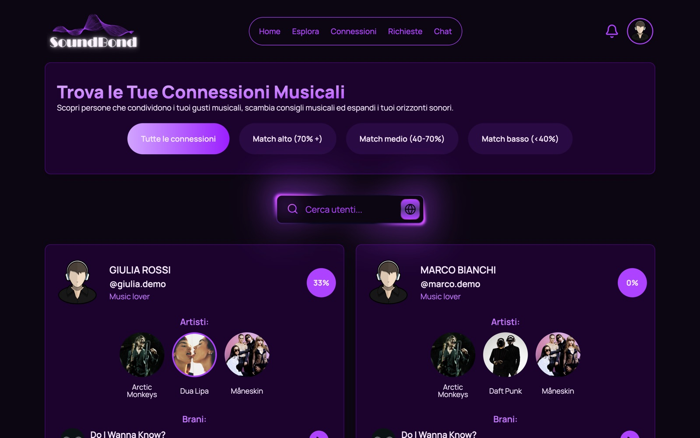

# SoundBond – Frontend

SoundBond è un social network musicale che mette in contatto persone con gusti simili: calcola la compatibilità tra utenti in base a generi e artisti preferiti e permette di connettersi e chattare in tempo reale.
Questo repository contiene il client web (React). L'API si trova in [SoundBond-Backend](https://github.com/camillazicari/SoundBond-Backend).



Progetto finale del corso di sviluppo web full-stack (aprile–luglio 2025), sviluppato da [Camilla Zicari](https://github.com/camillazicari).

## Funzionalità principali

- Registrazione e login con token JWT emessi dal backend (ASP.NET Identity).
- Onboarding dei gusti musicali: generi, artisti e brani preferiti, cercati tramite l'API di Deezer.
- Matching: percentuale di compatibilità con gli altri utenti, filtrabile per fascia (alta, media, bassa).
- Richieste di connessione, che una volta accettate creano un legame ("bond") tra due utenti.
- Chat privata in tempo reale con SignalR, con stato di lettura dei messaggi e notifiche nella barra di navigazione.
- Playlist consigliate in base ai generi preferiti e anteprime audio dei brani tramite Deezer.
- Profilo modificabile (immagine, bio, nome utente) e recensioni sulla piattaforma.

## Scelte tecniche

- **React 19 + Vite**, routing con React Router e rotte protette per le pagine riservate agli utenti autenticati.
- **Redux Toolkit** per lo stato condiviso (utente, gusti, connessioni, richieste, conversazioni); le chiamate all'API sono negli action creator in `src/redux/actions`.
- **SignalR** (`@microsoft/signalr`): una connessione autenticata con il JWT verso l'hub `/chatHub` del backend per messaggi e conferme di lettura.
- **Algoritmo di compatibilità** in `src/components/data/matchMaking.js`: il 60% del punteggio dipende dai generi in comune e il 40% dagli artisti in comune, normalizzati sulla lista più lunga dei due utenti.
- **Proxy Deezer** (`server.js`, Express): l'API pubblica di Deezer non consente chiamate dirette dal browser per via del CORS, quindi un piccolo server Node inoltra ricerche, generi, artisti e top brani.
- **Tailwind CSS 4** con componenti HeroUI, Radix e Ant Design; animazioni con Motion.

## Architettura

```
Browser (React, porta 5173)
   │  REST + JWT            ┌──────────────────────────────┐
   ├──────────────────────► │ SoundBond-Backend            │
   │  WebSocket (SignalR)   │ ASP.NET Core 8 – porta 5220  │──► SQL Server
   ├──────────────────────► │ /api/*  e  /chatHub          │
   │                        └──────────────────────────────┘
   │  REST
   └──────────────────────► Proxy Node (server.js, porta 5002) ──► API Deezer
```

## Avvio in locale

Prerequisiti: Node.js 20 o superiore e il [backend](https://github.com/camillazicari/SoundBond-Backend) avviato su `http://localhost:5220`.

```bash
git clone https://github.com/camillazicari/SoundBond-Frontend.git
cd SoundBond-Frontend/frontend
npm install
cp .env.example .env.local   # modifica gli URL solo se il backend gira altrove
```

Servono due processi, in due terminali:

```bash
node server.js     # proxy Deezer su http://localhost:5002
```

```bash
npm run dev        # app su http://localhost:5173
```

Il backend accetta richieste CORS da `http://localhost:5173`. Se Vite parte su un'altra porta, aggiungila a `Cors:AllowedOrigins` nel backend e ad `ALLOWED_ORIGINS` del proxy (per esempio `ALLOWED_ORIGINS=http://localhost:5174 node server.js`).

Per provare matching e chat senza registrare utenti a mano, il backend include uno script che crea quattro utenti dimostrativi: vedi `scripts/seed-demo.sh` nel repository del backend.

### Variabili d'ambiente

| Variabile | Default | Uso |
| --- | --- | --- |
| `VITE_API_URL` | `http://localhost:5220` | URL del backend ASP.NET Core (REST e SignalR) |
| `VITE_DEEZER_PROXY_URL` | `http://localhost:5002` | URL del proxy Deezer |
| `ALLOWED_ORIGINS` | `http://localhost:5173` | Origini ammesse dal proxy (`server.js`), separate da virgola |
| `PORT` | `5002` | Porta del proxy |

### Comandi

| Comando | Descrizione |
| --- | --- |
| `npm run dev` | Server di sviluppo Vite |
| `npm run build` | Build di produzione in `dist/` |
| `npm run preview` | Anteprima locale della build |
| `npm run lint` | ESLint |

## Struttura

```
frontend/
├── server.js              proxy Express verso l'API Deezer
└── src/
    ├── config.js          URL dei servizi (da variabili d'ambiente)
    ├── components/        pagine e componenti (Connessioni, Chat, Esplora, ...)
    │   └── data/          algoritmo di compatibilità
    ├── redux/             store, reducer e action con le chiamate all'API
    └── services/          connessione SignalR
```
